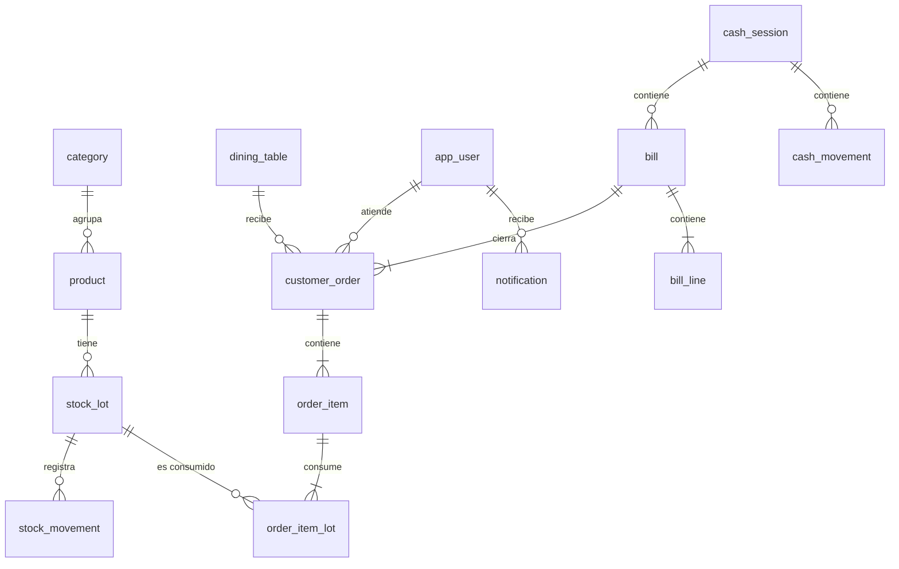

# 02 · Modelo de datos — La Cava (PostgreSQL)

Convenciones: `id BIGINT GENERATED ALWAYS AS IDENTITY`; dinero `NUMERIC(14,2)`; instantes `TIMESTAMPTZ`; fechas de calendario `DATE`; enums como `VARCHAR` con `CHECK`.

## Diagrama

## Tablas

### app_user
`id`, `username` varchar(40) único en minúsculas, `full_name` varchar(80), `password_hash`, `role` (`ADMIN`, `CASHIER`, `WAITER`, `KITCHEN`), `active` boolean, `created_at`.

### category
`id`, `name` varchar(40) `UNIQUE (lower(name))`.

### product
| Columna | Tipo | Reglas |
|---|---|---|
| id | bigint PK | |
| name | varchar(60) | `UNIQUE (lower(name))` |
| category_id | FK | |
| price | numeric(14,2) | `> 0` |
| description | varchar(120) | |
| icon | varchar(16) | emoji |
| min_stock | integer | `>= 0` |
| active | boolean | |
| season_name | varchar(40) | nullable |
| season_until | date | obligatorio si `season_name` no es nulo (`CHECK`) |
| created_at, updated_at | timestamptz | |

### stock_lot
| Columna | Tipo | Reglas |
|---|---|---|
| id | bigint PK | |
| product_id | FK | índice `(product_id, expires_on)` |
| quantity_received | integer | `> 0` |
| quantity_available | integer | `>= 0` y `<= quantity_received` |
| expires_on | date | no nulo |
| season_name | varchar(40) | nullable |
| received_at | timestamptz | |
| created_by | FK → app_user | |
| version | bigint | `@Version` |

### stock_movement
`id`, `product_id`, `lot_id` (nullable solo en eventos agregados), `type` (`LOT_IN`, `SALE`, `ORDER_CANCEL_RETURN`, `WASTE_OUT`, `DAMAGED_OUT`, `INTERNAL_USE_OUT`, `ADJUSTMENT_OUT`, `EXPIRED_WRITE_OFF`), `quantity` integer con signo, `note`, `order_id` nullable, `user_id`, `created_at`.

### dining_table
`id`, `number` integer único, `qr_token` varchar(64) único (HMAC), `pin` char(4), `active` boolean, `token_rotated_at`.

### customer_order
| Columna | Tipo | Reglas |
|---|---|---|
| id | bigint PK | el número visible del pedido es el `id` |
| table_id | FK | |
| waiter_id | FK → app_user (rol `WAITER`) | |
| created_by | FK → app_user | quien lo registró |
| status | varchar(16) | `PENDING`, `IN_PREPARATION`, `READY`, `DELIVERED`, `CLOSED`, `CANCELLED` |
| note | varchar(140) | |
| created_at, started_at, ready_at, delivered_at, closed_at, cancelled_at | timestamptz | según el estado |
| cancel_reason | varchar(120) | obligatorio si `CANCELLED` |
| bill_id | FK nullable | al cobrar |
| version | bigint | |

Índices: `(table_id) WHERE status IN ('PENDING','IN_PREPARATION','READY','DELIVERED')`, `(waiter_id, status)`, `(status, created_at)`.

### order_item
`id`, `order_id`, `product_id`, `product_name` (copia), `unit_price` (copia), `quantity` integer `> 0`, `note` varchar(80).

### order_item_lot
`order_item_id`, `lot_id`, `quantity` integer `> 0`. PK `(order_item_id, lot_id)`. Permite devolver al lote exacto si se cancela el pedido.

### notification
`id`, `user_id` (destinatario), `type` (`ORDER_READY`, `ORDER_CREATED`), `order_id`, `table_number`, `message` varchar(160), `created_at`, `read_at` nullable. Índice `(user_id) WHERE read_at IS NULL`.
Los avisos de `ORDER_CREATED` van a cada usuario activo con rol `KITCHEN`.

### cash_session, cash_movement, cash_count
Igual que en Proto: un solo turno `OPEN` (índice único parcial), base, apertura y cierre, esperado/contado/diferencia, movimientos `IN`/`OUT` con concepto y conteo por denominación.

### bill (factura)
| Columna | Tipo | Reglas |
|---|---|---|
| id | bigint PK | |
| number | varchar(16) | único: `'LC-' || año || '-' || lpad(nextval('bill_number_seq'), 5, '0')` |
| table_id | FK | |
| cash_session_id | FK | |
| cashier_id | FK → app_user | |
| payment_method | `CASH`, `TRANSFER`, `CARD` | |
| approval_code | varchar(30) | obligatorio si `CARD` |
| received_amount, change_amount | numeric(14,2) | solo `CASH` |
| total | numeric(14,2) | |
| customer_name, customer_doc, customer_email | varchar | opcionales |
| created_at | timestamptz | |

### bill_line
`id`, `bill_id`, `product_id`, `product_name`, `unit_price`, `quantity`, `subtotal`. Ítems consolidados por producto y precio (lo que se imprime).

## Datos de ejemplo (perfil `local`)
Los productos de la demo (Tabla La Cava, Tabla para dos, Copa de vino tinto, Vino botella, Cóctel de frutos rojos, Limonada natural, Agua, Postre de la casa, Tabla vegetariana sin lotes, Vino caliente navideño de temporada Navidad y Sangría de verano fuera de temporada) con lotes de distintas fechas, incluido uno vencido. 12 mesas. Usuarios: `admin`, `camila` (cajero), `laura` y `andres` (meseros), `jorge` (preparación); contraseña `<usuario>123`. Algunos pedidos en distintos estados y tres facturas del día.
